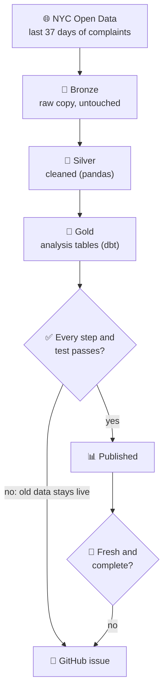

# NYC 311 Data Platform

[](https://github.com/mcarter100k/nyc311-data-platform/actions/workflows/ci.yml)
[](https://github.com/mcarter100k/nyc311-data-platform/actions/workflows/daily-run.yml)
[](https://github.com/mcarter100k/nyc311-data-platform/actions/workflows/terraform.yml)

**🔎 [Explore the live data model](https://mcarter100k.github.io/nyc311-data-platform/)**: every table, column and test, and how they connect.

**New York City logs about 10,000 non-emergency complaints a day (noise, potholes, illegal parking) through its 311 line. This project downloads them every day, cleans them, tests them, and turns them into tables anyone can analyze. When a run fails or misses one of its targets, it opens a GitHub issue on itself.**

| | |
|---|---|
| 🎯 **Problem** | The city's public data has traps: complaints "closed" before they were opened, each day's numbers keep changing for a week, and publishing can stall without any error. Analysis built on it as-is can be quietly wrong. |
| 🛠️ **Solution** | A pipeline that runs every day with no one touching it: download → clean → model → test → publish. |
| 🛡️ **Safety net** | <!--claim:dbt_test_count-->131<!--/claim--> data tests check every build. If one fails, the last good data stays live and a GitHub issue opens. |
| 🔍 **Insight** | Only **35–44%** of closures record the city acting on the problem (Aug 2026 sample) → [findings](#what-it-found) |
| 🧰 **Stack** | Python · pandas · SQL · dbt · DuckDB · Airflow · Terraform · GitHub Actions |

## How it works



Data moves through three layers, like ore → refined metal → finished part: **Bronze** keeps exactly what the city sent, **Silver** fixes it, **Gold** shapes it for questions. When a number looks wrong, you can trace it back one layer at a time.

## Skills demonstrated

| Skill | Evidence |
|---|---|
| **Data modeling** | Star schema with <!--claim:fct_models-->4<!--/claim--> fact tables and <!--claim:dim_models-->3<!--/claim--> dimensions, incremental loads, and an agency table that keeps its history → [models](local/models/marts/) · [live docs](https://mcarter100k.github.io/nyc311-data-platform/) |
| **Data quality** | <!--claim:test_count-->245<!--/claim--> automated tests on top of the data tests above; bad rows are set aside, not silently dropped → [tests](tests/) |
| **Reliability** | Two written targets (SLOs) checked daily, a heartbeat monitor, and a postmortem of a real incident where every step ran green and only a volume check caught it → [SLOs](docs/SLO.md) · [postmortem](docs/postmortems/2026-08-18-upstream-publish-stall.md) |
| **Orchestration** | Runs daily on GitHub Actions; the same pipeline can also run on a laptop as a 7-task DAG in Airflow (demo) → [workflow](.github/workflows/daily-run.yml) · [DAG](airflow/dags/nyc311_local.py) |
| **Infrastructure as code** | Terraform for a Snowflake warehouse (5 schemas, 4 roles, least-privilege access; designed and validated, not deployed) and for this repo's own GitHub settings (live) → [terraform](terraform/) |
| **Decision-making** | <!--claim:adr_count-->18<!--/claim--> written decision records, each weighing the options → [ADRs](#architecture-decision-records) |
| **Honest docs** | CI fails if a count, link, task name or quoted query in the docs drifts from the code → [claims register](docs/CLAIMS.md) |

## What it found

- **"Closed" usually doesn't mean "fixed."** In 12 days of Aug 2026 data (89,506 closures), most closures record *no violation found*, *nothing there*, a duplicate, or a hand-off rather than the city acting. For homeless-services complaints, only 17–20% record action.
- **Failed visits come back.** When the city couldn't get access, the same complaint returns to the same address within 3 days 13.8% of the time. The exact rate varies with how it's measured, but it ranks first among identifiable closure types in all eight ways tried.

Full numbers, methodology, and the mistakes found and corrected along the way: [docs/FINDINGS.md](docs/FINDINGS.md).

## Run it

Needs Python 3.11+ and internet access. No accounts or keys. Run from the repo root.

```bash
python3 -m venv .venv && source .venv/bin/activate
pip install -r local/requirements.txt -r dbt/requirements.txt -r requirements-dev.txt
python local/local_runner.py     # download 10,000 recent complaints and build everything (1-2 min)
```

<details>
<summary><b>More commands</b></summary>

```bash
python local/local_runner.py --live     # what the daily run does: 37 days, ~385k rows, ~8 min
python local/local_runner.py --stage 4  # resume from a stage (1 fetch ... 5 print results)
python local/reconcile.py               # check Gold against the raw file and the live API
./run_tests.sh                          # rebuild the dbt manifest, run every pytest tier
python scripts/check_claims.py          # the docs-vs-code check
```

CI runs the install above from a clean checkout on every push to `main` and every pull request.

**Skip the build:** every [daily run](https://github.com/mcarter100k/nyc311-data-platform/actions/workflows/daily-run.yml) attaches its finished database and the raw download as an artifact, kept for 14 days (downloading needs a GitHub sign-in). To query the results, see [Reproduce it](docs/FINDINGS.md#reproduce-it). The Airflow demo has its own setup in [`scripts/airflow_local.sh`](scripts/airflow_local.sh).

</details>

## Learn more

<details>
<summary><b>📖 New to data engineering? A plain-English glossary</b></summary>

| Term | Meaning |
|---|---|
| **311** | New York's phone line and app for non-emergency complaints |
| **API** | A web address a program can ask for data; here, NYC Open Data's Socrata API |
| **Pipeline** | A chain of steps that moves data from where it starts to where it's useful |
| **Bronze / Silver / Gold** | Raw → cleaned → ready to analyze (the "medallion" pattern) |
| **Star schema** | One central table of events (a *fact*: one row per complaint) linked to lookup tables that describe it (*dimensions*: agency, date, location) |
| **dbt** | A tool that builds tables from SQL files kept in version control, and tests them |
| **DuckDB** | A database that lives in a single file, so the whole project runs on a laptop |
| **Snowflake** | A cloud data warehouse; designed here but not deployed |
| **SLO** | A written, measured target, such as "a run loaded new rows in the last 26 hours"; missing it raises an alert |
| **Write-audit-publish** | Build new tables off to the side, test them, and swap them in only if every test passes |
| **Airflow** | A scheduler that runs pipeline steps in order and shows which one failed |
| **DAG** | The ordered list of steps Airflow runs |
| **Terraform** | Describes infrastructure (databases, permissions, repo settings) as code |
| **CI** | Checks that run automatically on every code change |
| **ADR** | Architecture Decision Record: a short note on why one option was chosen over others |
| **Postmortem** | A blameless write-up of what went wrong and what changed afterwards |

</details>

<details>
<summary><b>⚙️ How it runs, and how failures get caught</b></summary>

[`daily-run.yml`](.github/workflows/daily-run.yml) runs the pipeline every day (cron 10:00 UTC; GitHub usually starts it 3–8 hours late). Each run re-downloads about 385,000 requests from the last 37 days. History since 11 Aug 2026 carries over between runs in the GitHub Actions cache ([ADR 017](docs/adr/017-history-lives-in-the-actions-cache.md)).

After each run, two promises are checked:

| SLO | Question | Threshold |
|---|---|---|
| **SLO-1 freshness** | Did a run recently load rows? | newest load < 26 hours old |
| **SLO-2 completeness** | Did we load what the city published? | ≥ 98% of the city's own count, on every day the city has finished publishing |

A failed run or broken SLO opens a `daily-run-breach` issue with the measured numbers ([docs/SLO.md](docs/SLO.md)). Two more checks cover what the SLOs can't see:

- **Upstream stall.** If the city stops publishing, the run stays green (the loss isn't ours) but an `upstream-stall` issue opens. This came out of a real incident ([postmortem](docs/postmortems/2026-08-18-upstream-publish-stall.md)).
- **Heartbeat.** A check inside the daily run can't report a run that never starts. A separate [heartbeat](.github/workflows/heartbeat.yml) alerts if the daily run is disabled or hasn't succeeded in 30 hours.

**Why 37 days.** The pipeline only sees a complaint's status change while the complaint is inside the download window. NYC's closure standard is 30 days, and the city's data for a day keeps shifting for about 7 more ([ADR 016](docs/adr/016-source-settling-horizon.md)), so the window is 30 + 7. Fetching only what changed (`:updated_at`) was measured and rejected: the city re-stamps about half a million rows a night ([ADR 010](docs/adr/010-scheduled-operation.md)).

Layer-by-layer detail and the model list: [docs/ARCHITECTURE.md](docs/ARCHITECTURE.md). The test tiers: [Testing](docs/ARCHITECTURE.md#testing).

</details>

<details>
<summary><b>🧭 What runs vs. what is only designed</b></summary>

**Runs:** the DuckDB pipeline, the daily run, an Airflow demo (a 7-task DAG), three required CI checks, and Terraform for this repo's own GitHub settings ([terraform/github/](terraform/github/)). Gold is published by write-audit-publish: a failed dbt test fails the run and leaves Gold exactly as it was ([ADR 018](docs/adr/018-write-audit-publish-on-duckdb.md)).

**Designed, not deployed:** a Snowflake warehouse with 5 schemas, 4 roles and least-privilege grants ([terraform/](terraform/), validated in CI, never applied), and its one-statement schema-swap publish ([ADR 005](docs/adr/005-orchestration-strategy.md)). The dbt project therefore exists twice: [`local/`](local/) for DuckDB, which runs, and [`dbt/`](dbt/) for Snowflake. CI fails if they differ in anything but SQL dialect.

</details>

<details>
<summary><b>🗂️ Where things live</b></summary>

| Folder | What's in it |
|---|---|
| [`local/`](local/) | The pipeline (`local_runner.py`) and the DuckDB dbt project: what runs |
| [`dbt/`](dbt/) | The Snowflake dbt project (designed, never run against a warehouse) |
| [`airflow/dags/`](airflow/dags/) | The Airflow demo DAG |
| [`terraform/`](terraform/) | Snowflake infrastructure (never applied) · [`github/`](terraform/github/): this repo's settings (applied) |
| [`scripts/`](scripts/) | SLO queries, heartbeat and stall checks, docs and drift checks |
| [`tests/`](tests/) | pytest suites |
| [`docs/`](docs/) | Architecture, findings, SLOs, decision records, postmortem |
| [`config/`](config/) | The borough-name mapping |

</details>

## Architecture Decision Records

<details>
<summary><b>All <!--claim:adr_count-->18<!--/claim--> decisions</b></summary>

| ADR | Decision |
|---|---|
| [001](docs/adr/001-warehouse-selection.md) | Snowflake over Databricks SQL for the serving layer |
| [002](docs/adr/002-transformation-tool.md) | dbt over hand-written transform code for Gold |
| [003](docs/adr/003-iac-approach.md) | Terraform as the one infrastructure-as-code tool |
| [004](docs/adr/004-medallion-vs-elt.md) | Medallion layering over direct ELT |
| [005](docs/adr/005-orchestration-strategy.md) | Airflow, one DAG, write-audit-publish dbt stage (Snowflake schema swap; specified only) |
| [006](docs/adr/006-schema-evolution.md) | A schema version stamp on each fact row, not runtime column detection |
| [007](docs/adr/007-scd-type-2-dim-agency.md) | Agency history as SCD Type 2 via a dbt snapshot, so a 2021 request keeps its 2021 agency name |
| [008](docs/adr/008-prototype-scope.md) | Cloud services specified, not provisioned |
| [009](docs/adr/009-publish-grants-under-schema-swap.md) | Reader grants on both GOLD and GOLD_AUDIT, so the publish swap keeps access |
| [010](docs/adr/010-scheduled-operation.md) | Run daily against the live source, with written SLOs |
| [011](docs/adr/011-parallel-ci-tiers.md) | Three parallel required CI checks, not one sequential job |
| [012](docs/adr/012-github-repo-as-code.md) | This repository's own settings are Terraform, and applied |
| [013](docs/adr/013-no-source-freshness-slo.md) | No source-freshness SLO: gate on what we control, warn on what we don't |
| [014](docs/adr/014-transform-before-load.md) | Transform before load: Bronze is the raw file, not a warehouse table |
| [015](docs/adr/015-slo2-population-is-complete-days.md) | SLO-2 checks the days the data shows are complete, not a fixed offset from today |
| [016](docs/adr/016-source-settling-horizon.md) | NYC 311 data settles after 7 days |
| [017](docs/adr/017-history-lives-in-the-actions-cache.md) | Gold's history lives in the GitHub Actions cache; losing it files an issue |
| [018](docs/adr/018-write-audit-publish-on-duckdb.md) | Write-audit-publish on DuckDB: build and test in an audit schema, publish by copy in one transaction |

</details>

---

**Marquis Carter** · Data Engineer · marq.dcarter@gmail.com · [LinkedIn](https://www.linkedin.com/in/marquis-c-45132325b/) · [GitHub](https://github.com/mcarter100k)
